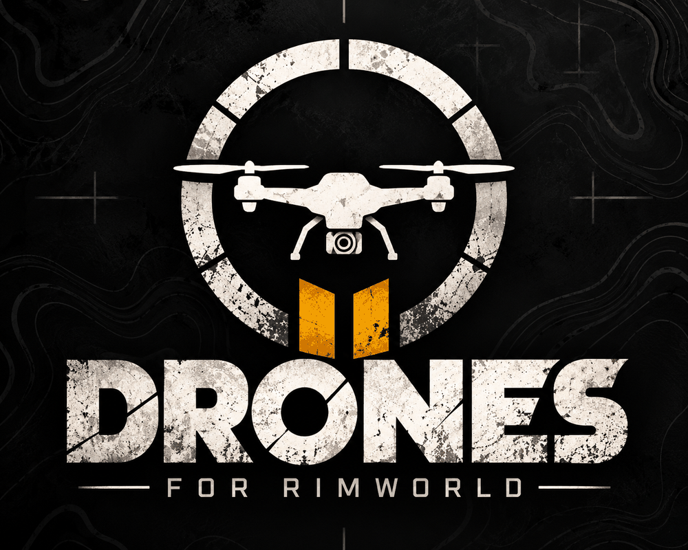
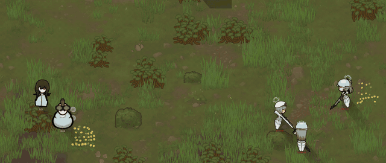
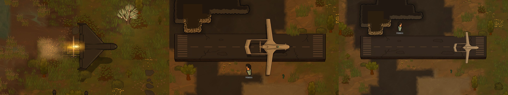
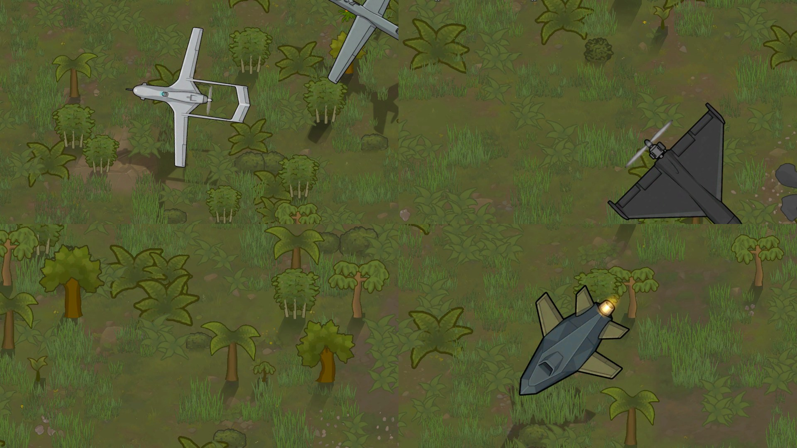
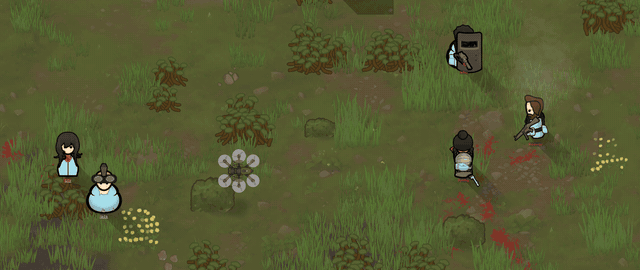
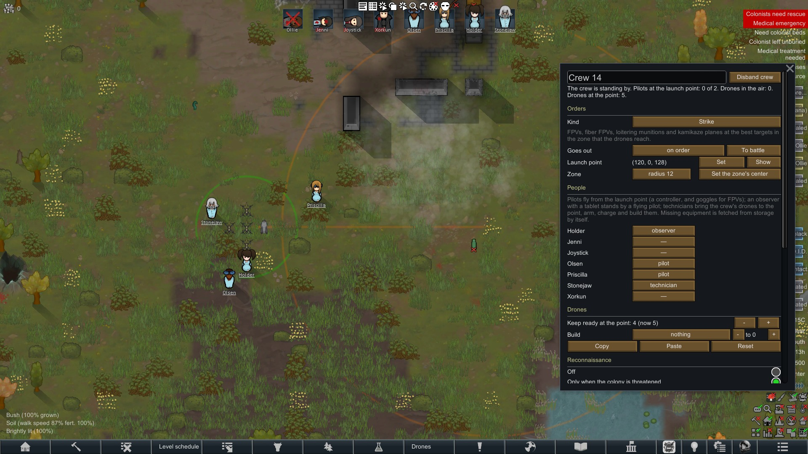
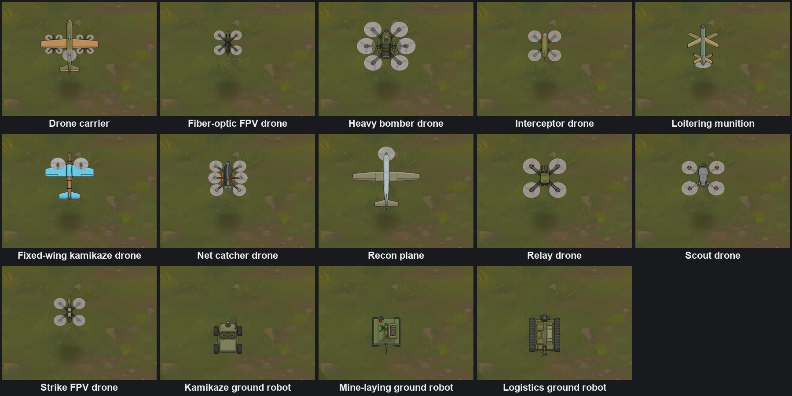

# Modern Drone Warfare

*A RimWorld mod* — **[Get it on the Steam Workshop](https://steamcommunity.com/sharedfiles/filedetails/?id=3818148083)**

## Support the author

The mod is free and stays free. If you enjoy it and want to help it grow, here is how — thank you!

- **Ukraine:** [Monobank](https://send.monobank.ua/jar/9DhoxpMnqU) · Jar card `4874 1000 3495 0520`
- **Russia and CIS:** [FunPay](https://funpay.com/lots/offer?id=79818332)
- **Crypto (USDT, BEP20 / BSC):** `0x6f64350f5b2781a2c7af12af5cf2f8a24715cf53` — Only USDT on BNB Smart Chain (BEP20) — other networks or tokens will be lost.

Drone warfare the way it really works: you don't just build drones, you fly them — with crews of pilots, observers and technicians, over a radio link that walls, woods, weather and jamming can break.

### What may surprise you

- Crews fight on their own: on alarm they drop their work, run to the launch point and take off; technicians build, arm and charge the drones.
- The link is everything. Five real radio kits, each with its own range and picture, and the enemy retunes its jammers to the ones you fly on most. Fiber-optic FPVs ignore jamming but drag a cable across the map: cut it and the drone goes blind.
- The enemy hunts your operators by direction finding; your video receiver shows where its FPV is heading.
- Night raids by Shahed / Geran-class drones off launch rails, strikes back on the world map, TB2-class planes rolling down a runway.
- What is mounted is what you see: warheads, drops and the satellite modem are drawn on the drone. Real prototype names for your side: Ukrainian, Russian or Western.
- Air defense from jammer guns and nets to flak, lasers, microwaves and GPS spoofing — and your own EW can blind your own drones.

<b>Українська — Сучасна безпілотна війна</b>

Війна дронів така, якою вона є: дрони мало збудувати, ними треба літати — розрахунками з пілотів, спостерігачів і техніків, через радіозв'язок, який рвуть стіни, ліс, погода й РЕБ.

### Чим може здивувати

- Екіпажі воюють самі: за тривогою кидають роботу, біжать на точку й злітають; техніки збирають, споряджають і заряджають дрони.
- Зв'язок вирішує все. П'ять реальних радіокомплектів зі своєю дальністю й картинкою, а ворог перебудовує глушилки під ті, на яких ви літаєте найчастіше. Оптоволоконний FPV не боїться РЕБ, але тягне кабель через усю мапу: переріжте — і дрон осліп.
- Ворог пеленгує ваших операторів, а ваш відеоприймач показує, куди летить його FPV.
- Нічні нальоти «Шахедів» із пускових напрямних, удари у відповідь по мапі світу, літаки класу TB2 з розбігом по злітній смузі.
- Що підвішено, те й видно: БЧ, скиди й супутниковий модем намальовані на дроні. Назви реальних прототипів вашої сторони: українські, російські або західні.
- ППО від РЕБ-рушниць і сіток до зеніток, лазерів, НВЧ і підміни GPS — а своя РЕБ може осліпити власні дрони.

<b>Русский — Современная беспилотная война</b>

Война дронов такой, какая она есть: дроны мало построить, ими надо летать — расчётами из пилотов, наблюдателей и техников, по радиосвязи, которую рвут стены, лес, погода и РЭБ.

### Чем может удивить

- Экипажи воюют сами: по тревоге бросают работу, бегут на точку и взлетают; техники собирают, снаряжают и заряжают дроны.
- Связь решает всё. Пять реальных радиокомплектов со своей дальностью и картинкой, а враг перестраивает глушилки под те, на которых вы летаете чаще. Оптоволоконный FPV не боится РЭБ, но тянет кабель через всю карту: перережьте — и дрон ослеп.
- Враг пеленгует ваших операторов, а ваш видеоприёмник показывает, куда летит его FPV.
- Ночные налёты «Шахедов» с пусковых направляющих, ответные удары по карте мира, самолёты класса TB2 с разбегом по взлётной полосе.
- Что подвешено, то и видно: БЧ, сбросы и спутниковый модем нарисованы на дроне. Названия реальных прототипов вашей стороны: украинские, российские или западные.
- ПВО от РЭБ-ружей и сетей до зениток, лазеров, СВЧ и подмены GPS — а своя РЭБ может ослепить свои же дроны.

## Screenshots

*This mod is about the mechanics of drone warfare, not about politics.*
